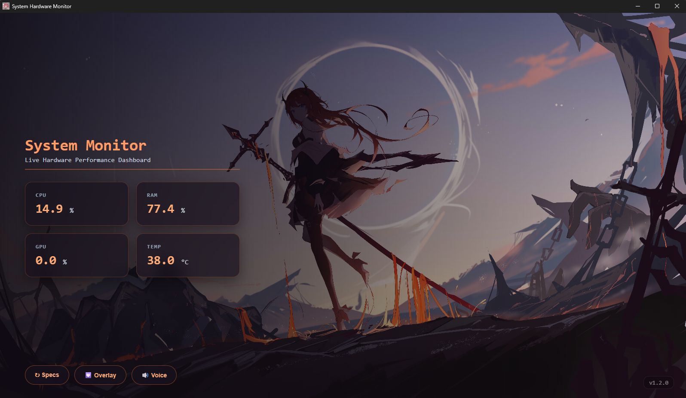
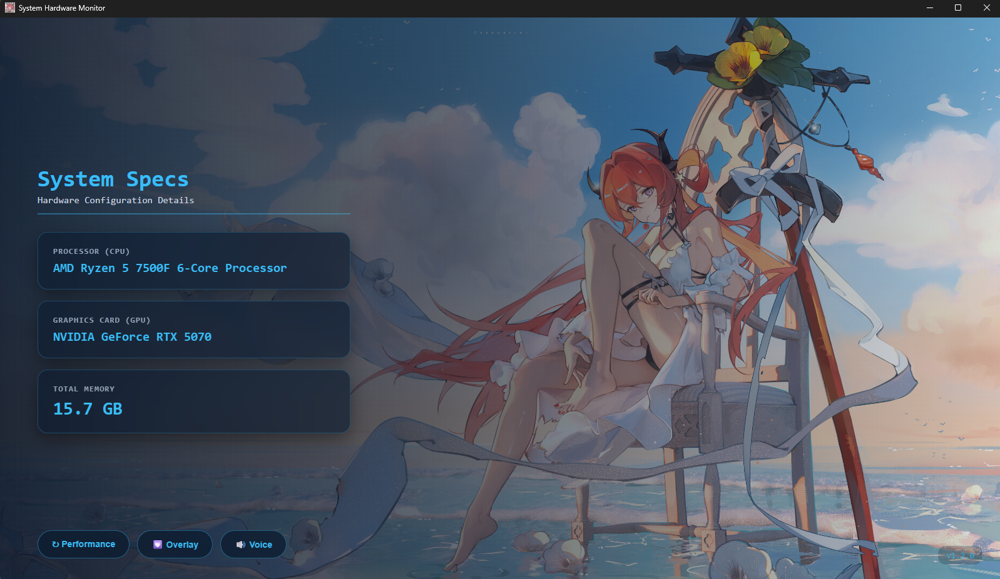
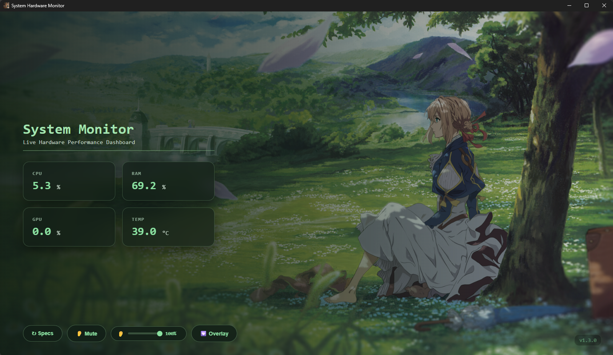
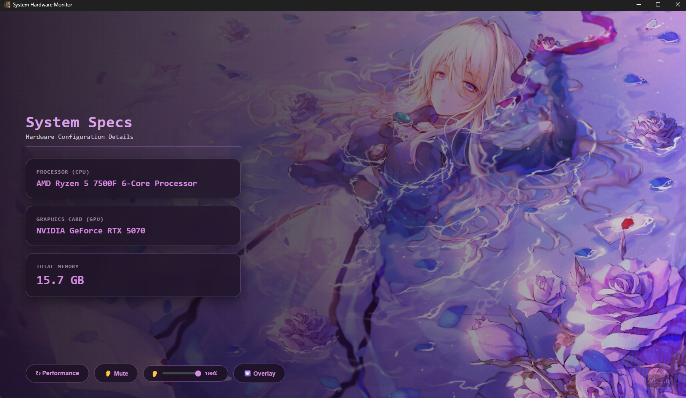

# System Monitor App 🖥️

A lightweight C++ desktop system monitor application built for personal learning—specifically to explore how to integrate modern front-end web technologies with a native C++ backend.
---

## 📌 Project Overview

This project serves as a practical hands-on experiment in building a desktop application with a web-based UI. It runs an embedded local web server via a C++ backend to handle routing, API requests, and system data, while rendering the interface through a native webview window.

> 🔀 **Branch Information**:
> - **`main`**: Features standard live hardware monitoring, system specs view, OSD overlay, and interactive voice line playback (`/api/play_voice`).
> - **`background-muisc-version`**: Adds an embedded multi-track background music (BGM) loop engine, volume slider control, mute toggling, and specialized windowing enhancements.

---

## ✨ Features

- **Live Stats**: Check CPU usage, RAM usage, GPU usage, and GPU temperature.
- **PC Specs**: View your processor name, graphics card, and total RAM.
- **2 View Modes**: 
  - **Window Mode**: Full dashboard with background images.
  - **Overlay Mode**: Small floating widget you can drag around.
- **Audio Support**: Plays voice clips or background music.

### 🖼️ Preview (Not the lastest version)
<table align="center">
  <tr>
    <td align="center" width="50%">
      <br>
    </td>
    <td align="center" width="50%">
      <br>
    </td>
  </tr>
  <tr>
    <td align="center" width="50%">
      <br>
    </td>
    <td align="center" width="50%">
      <br>
    </td>
  </tr>
</table>

---

## 🛠️ Tech Stack & Details

- **Core Language**: C++ (MSVC / C++17)
- **Desktop UI / Window**: [WebView](https://github.com/webview/webview) (Tiny cross-platform web view library using WinAPI/WebView2)
- **Backend Microframework**: [Crow](https://github.com/CrowCpp/Crow) (C++ HTTP microframework for REST API endpoints and local web serving)
- **Asynchronous I/O**: [Asio](https://think-async.com/Asio/) (Standalone C++ library for network operations)
- **Frontend Interface**: HTML5, CSS3, JavaScript (ES6+ with Fetch API)
- **Native Windows APIs**:
  - `nvml.dll` (NVIDIA Management Library)
  - `atiadlxx.dll` / `atiadlxy.dll` (AMD Display Library)
  - `ze_loader.dll` / `PDH` / `WMI` (Intel GPU & Thermal sensors)
  - `winmm.lib` (Multimedia Audio API)

---

## 📦 Dependencies & Requirements

To build and run this project from source, make sure you have the following configured in your Visual Studio build environment:

1. **Windows OS** (Windows 10/11)
2. **Visual Studio 2022** (with *Desktop development with C++*)
3. **C++ Libraries** (included in source or header-only):
   - [WebView](https://github.com/webview/webview) (`webview.h`)
   - [Asio Standalone](https://think-async.com/Asio/) (`asio.hpp` / `asio/`)
   - [Crow Framework](https://github.com/CrowCpp/Crow) (`crow.h` / `crow/`)

---

## 🚀 Getting Started

### Option 1: Download Executable (Recommended)

1. Go to the [Releases](https://github.com/xiaokuai0915/System-Monitor-App/releases) page on GitHub.
2. Download the latest `.zip` or `.exe` file.
3. Extract and run the executable directly (no installation needed).

### Option 2: Build from Source (Visual Studio)
1. **Clone the Repository**:
   ```bash
   git clone https://github.com/xiaokuai0915/System-Monitor-App.git
   ```

2. **Create a Visual Studio Project**:
   - Open Visual Studio and create a new **C++ Windows Desktop Application** or **Console Application**.
   - Add the source files from the branch to your project:
     - `main.cpp`
     - `resource.h` and `Resource.rc`

3. **Configure Project Settings**:
   - **C++ Language Standard**: Set to **C++17** or higher (`Project Properties -> C/C++ -> Language`).
   - **Include Directories**: Ensure headers for `crow`, `asio`, and `webview` are in your include path.
   - **Linker Dependencies**: Add `winmm.lib`, `pdh.lib`, and `wbemuuid.lib` under `Linker -> Input -> Additional Dependencies`.

4. **Compile and Run**:
   - Select **Release | x64**.
   - Press `Ctrl + Shift + B` to build, and `Ctrl + F5` to run.

---

## 📄 License

Distributed under the **MIT License**. See `License` for details.
